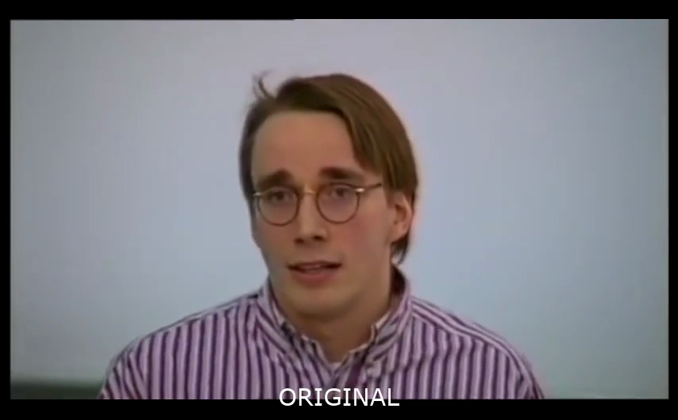

# DubbLM


DubbLM is an AI video dubbing system for high-quality, context-aware translation, speech synthesis, and video assembly. It can be used through a React UI, a FastAPI backend, a one-shot external API, or the original CLI workflow.

## Important Notice

**DubbLM is optimized for quality, not real-time processing.** The system analyzes speaker context, translates dialogue with LLMs, refines wording, synthesizes speech, adjusts timing, and rebuilds the final video. Processing can take significantly longer than the source video duration, especially with premium TTS, background preservation, LLM editor passes, or high-resolution video settings.

## What It Does

- **Context-aware translation** with OpenRouter-backed LLMs (Gemini, GPT, Claude, and others).
- **React UI workflow** for project upload, presets, transcription, segment editing, dubbing, and result download.
- **FastAPI + Celery backend** for persistent projects, async processing, progress streaming, and external integrations.
- **Segment editor** for translation edits, speaker renaming, voice assignment, TTS previews, rephrasing, muting, and cache resets.
- **Multiple TTS providers** including Gemini, OpenAI, MiniMax, and local/F5/Coqui paths where configured.
- **Speaker-aware controls** including diarization, voice matching, per-speaker prompts, and gender inference/overrides.
- **Timing and video controls** for background audio, original-audio ranges, segment stretching, volume, subtitles, and quality presets.
- **Reports and cost tracking** with per-stage API usage, downloadable artifacts, and summary reports.

## How It Works

The DubbLM pipeline is split into async stages:

1. **Upload and project setup** - Store source video and project config.
2. **Audio extraction and diarization** - Identify speakers and speech ranges.
3. **Transcription** - Convert speech to text and diarize speakers with OpenRouter `microsoft/mai-transcribe-2` (default); AssemblyAI, OpenAI + PyAnnote, and WhisperX remain legacy options.
4. **Context analysis and translation** - Translate with full dialogue context and optional glossary/prompt guidance.
5. **Refinement and editor pass** - Apply persona/style refinement and optional LLM editor improvements.
6. **Segment review** - Edit text, speakers, voices, prompts, and preview TTS before final dubbing.
7. **Speech synthesis** - Generate per-segment speech with selected TTS providers and voice mappings.
8. **Audio/video assembly** - Align speech, preserve background if requested, generate subtitles, and encode the final video.
9. **Report generation** - Store cost, timing, artifacts, and downloadable summary data.

## Interfaces

### Web UI

The UI is the main workflow for interactive use:

- Project list with persistent project state.
- Batch upload and background upload progress.
- **URL download**: paste links from YouTube and other yt-dlp-supported sites, choose quality, and download through the backend.
- Presets: `fast`, `hq`, and `ultra`.
- Server-side API key management.
- Live processing logs and progress via SSE.
- Segment editor after transcription.
- Final result view with video streaming, downloads, subtitles, report, and API cost panel.
- **Optional publishing to ИИ Борщ**: when `BORSCH_PUBLISH_ENABLED=true`, the result view can generate a card with an LLM from the project artifacts and publish the dubbed video to the ИИ Борщ library. The first click asks for the ИИ Борщ admin token; it is kept only in the browser (`localStorage`) and is never written to DubbLM `.env` or the database.

### API

The backend exposes `FastAPI` routes under `/api/v1`:

- Project workflow: create projects, upload videos, download videos from URLs, update config, transcribe, edit segments, dub, download.
- One-shot workflow: `POST /api/v1/translate` uploads a video and starts the full pipeline.
- Status: polling through job status endpoints or live SSE through `/projects/{projectId}/status`.
- Resources: voices, personas, languages, presets, settings, thumbnails, frames, reports, and artifacts.

Swagger UI is available at:

```text
http://localhost:8000/api/v1/docs
```

See [examples/external_translate_api.md](examples/external_translate_api.md) for detailed external API documentation.

### CLI

The CLI remains useful for scripts, local experiments, and batch jobs:

```bash
python dubblm_cli.py --input video.mp4 --source_language en --target_language ru
```

CLI options are loaded from `dubbing_config.yml` by default and can be overridden with flags.

## Installation

### Requirements

- Python 3.12+
- FFmpeg and FFprobe
- Redis for the API/Celery workflow
- Node.js 20+ for the frontend
- CUDA is optional, mainly for local WhisperX/GPU-heavy paths

### Python Setup

```bash
# Ubuntu/Debian
sudo apt update
sudo apt install ffmpeg redis-server python3.12 python3.12-venv

# macOS
brew install ffmpeg redis python@3.12
brew services start redis

# Clone and install
git clone https://github.com/ArteusAI/DubbLM.git
cd DubbLM
python3.12 -m venv .venv
source .venv/bin/activate
pip install uv
uv pip install -r requirements.txt

# Configure environment
cp env.example .env
```

Edit `.env` with the API keys you need. Alternatively, start the app and use
the first-run setup screen: it asks only for the OpenRouter key and writes it
to `.env` and `settings.yml`.

## API Keys

DubbLM can read keys from `.env` or from server-side settings saved by the UI.

The default `fast`, `hq`, and `ultra` profiles need one key:

```env
OPENROUTER_API_KEY=sk-or-...
```

The first-run web wizard asks for this key and writes it to `.env` and
`settings.yml`. It covers transcription/diarization, translation, refinement,
TTS, and emotion enrichment.

Optional legacy/advanced keys (not needed for the default profiles):

- `OPENAI_API_KEY` - legacy OpenAI TTS and OpenAI transcription paths.
- `GOOGLE_API_KEY` / `GEMINI_API_KEY` - legacy direct Gemini paths.
- `ASSEMBLYAI_API_KEY` - legacy direct AssemblyAI transcription.
- `HF_TOKEN` - optional Hugging Face access for local models.
- `MINIMAX_API_KEY` / `MINIMAX_GROUP_ID` - legacy MiniMax TTS.

### First-run setup

The default `fast`, `hq`, and `ultra` profiles need only one key:

```env
OPENROUTER_API_KEY=sk-or-...
```

Start DubbLM and open the web UI. The first-run wizard asks for the OpenRouter
key, validates it, and writes it to `.env` and `settings.yml`. The key covers
transcription/diarization, translation, refinement, TTS, and emotion
enrichment. Google, OpenAI, AssemblyAI, and MiniMax keys are optional legacy
paths.

If the app runs in Docker and the mounted `.env` is not writable, the key is
still persisted in `settings.yml` and applied to the runtime environment.

## Running the Web App

Start Redis first if it is not already running:

```bash
redis-server
```

Start the backend API:

```bash
source .venv/bin/activate
python run_api.py
```

Start the Celery worker in a second terminal:

```bash
source .venv/bin/activate
python run_worker.py
```

Start the frontend in a third terminal:

```bash
cd src/frontend
npm install
API_URL=http://localhost:8000 npm run dev
```

Open:

```text
http://localhost:3000
```

The frontend proxies `/api` to `API_URL`; the backend defaults to port `8000`.

## UI Workflow

1. Open the project dashboard.
2. Upload one or more videos, or paste a video URL (YouTube, Vimeo, TikTok, and other yt-dlp-supported sites) and pick a download quality.
3. Choose source/target language and a preset:
   - `fast` - Faster, lighter TTS, 720p output.
   - `hq` - Balanced quality, 1080p output.
   - `ultra` - Default release profile: OpenRouter MAI diarization, `google/gemini-4-carbon` refinement, Gemini 3.8 Flash TTS via OpenRouter, original quality.
4. Configure advanced options if needed: provider/model, TTS style, voice mappings, prompt prefixes, segment merge/stretch settings, background/original audio ranges, subtitles, and workers.
5. Start transcription.
6. Review and edit segments in the editor.
7. Preview TTS for individual segments and adjust voices/prompts.
8. Start final dubbing.
9. Download video, subtitles, report, and inspect cost/timing statistics.

## Segment Editor

After transcription, the editor supports:

- Editing translated segment text.
- Muting segments.
- Rephrasing a segment with an LLM prompt.
- Generating and replaying TTS previews.
- Renaming speakers globally.
- Changing a speaker voice across all matching segments.
- Setting per-segment or per-speaker TTS prompts.
- Overriding inferred speaker gender, then re-running translation when required.
- Resetting only TTS cache while keeping transcription and translation.

If gender overrides change after translation, the backend blocks final dubbing until translation is refreshed so grammatical gender can stay consistent.

## Presets and Configuration

`dubbing_config.yml` is the main configuration file for CLI defaults and UI/API preset defaults.

Important configuration areas:

- `default_preset` and `presets.fast|hq|ultra`
- `source_language`, `target_language`
- `transcription_system`, `whisper_model`, `speakers_expected`
- `llm_provider`, `llm_model_name`, `refinement_*`, `editor_*`
- `tts_system`, `tts_model`, `tts_fallback_model`, `tts_prompt_prefix`
- `voice_auto_selection`, `voice_name`, `voice_prompt`, `tts_system_mapping`
- `keep_background`, `keep_original_audio_ranges`, `dubbed_volume`, `background_volume`
- `background_voice_volume` — the "background voice" layer: the original voice (separated vocals stem) is mixed **under** the dubbed track, quieter than the dub. `0` disables the layer. The original voice is warped onto the timeline of the dubbed track, so it stays in sync with the dub.
- `enable_laughter_detection` — detect laughter moments. With `laughter_mode: dub` they become TTS laughter tags; with `laughter_mode: preserve` the original laughter is kept and the original/background layer is smoothly raised to `laughter_volume` (default `0.70`) during the detected ranges. The translation segments and their timing are **not** changed in preserve mode. Off by default in `ultra`; when enabled, requires a one-time download of the `omine-me/LaughterSegmentation` model (research use only) plus its wav2vec2 base model into the Hugging Face cache.
- `laughter_mode` — `dub` (voice laughter with TTS tags) or `preserve` (keep original laughter, raise the original/background layer via a volume envelope; translation timing stays untouched).
- `laughter_volume` / `laughter_volume_ramp_seconds` — target gain inside laughter ranges and the fade-in/out length of the envelope (defaults `0.70` and `0.25s`).
- `enable_vocal_event_detection` — detect non-verbal vocal events (screams, sobbing, gasps, whispers, sighs, pants, ...) with the AST AudioSet model (`MIT/ast-finetuned-audioset-10-10-0.4593`) and either voice them with Gemini 3.8 inline tags or preserve the original performance. Detection runs on the separated vocals stem when available (much cleaner on music-heavy material). Legacy option, off by default.
- `enable_vocal_event_loudness_detection` — a second signal for shouted lines: the AudioSet model does not recognise shouted dialogue (it keeps scoring "Speech"), so the loudness envelope of the vocals stem is used to find the loudest passages. The threshold is relative to the loud speech level of the material, so emphatic dialogue stays out. Legacy option, off by default; only useful with `vocal_events_mode: preserve`.
- `vocal_events_mode` — `preserve` (keep the original scream/sob audio and arrange the translated speech around it; default) or `dub` (render the events with TTS vocal tags).
- `vocal_event_kinds` — subset of `laugh, cry, scream, shout, whisper, gasp, pant, sigh, groan, grunt, whimper, breath, snort` to detect.
- `enable_emotion_enrichment` — in addition to inline tag hints, labels each translated line with a canonical emotion that Gemini 3.8 receives as a sustained delivery style.
- `enable_video_emotion_analysis` — delivery analysis with a Gemini VLM. The trailer is sent as **one stream** (a downscaled ffmpeg proxy that keeps the original audio), so the model sees the picture and hears the voice at the same time and can judge how a line is actually performed. Per line it returns a canonical emotion, an intensity and a short director's note; the emotion becomes the sustained style (Gemini 3.8 `speech_metadata.style`) and the note is merged into the direction (Fish Audio Drama 3: `[tense, restrained, rising urgency] ...`). Analysis windows are expanded to quiet points around the first and last transcript line, so the VLM never sees a hard cut through a breath, laugh or syllable. The result is stored per segment (`emotion`, `emotion_intensity`, `emotion_direction`), so it survives a re-dub and shows up in the preview. Legacy option, off by default (`video_emotion_analysis_model`, `video_emotion_analysis_fps`, `video_emotion_analysis_direction_max_chars`, `video_emotion_analysis_language` tune it). When it is on, the text-only emotion labeling of the refinement LLM is skipped: the VLM sees the actual performance and wins.
- `enable_voice_advisor` — voice advice. The same VLM request also describes the **voice of every character** (timbre, age impression, energy, accent), so no extra call is needed. The advice is a recommendation: it narrows the candidate voices (the gender / age / accent filters stay authoritative, the embedding matcher still picks inside the shortlist) and it enriches the delivery instruction (the timbre joins the style of Gemini 3.8 and the direction of Drama 3). The advice is stored in `config["speakerVoiceProfiles"]`, shown in the UI next to the per-speaker voice mapping and can be copied into the speaker prompt with one click. `voice_advice_max_candidates` (default 8) sets how many voices stay in the shortlist; the gender aware default is always kept as a safety net. Legacy option, off by default.
- `refiner_emotion_tags` — let the refinement LLM own inline delivery tags and skip the runtime Gemini 3.8 tag enricher (avoids double tags). Legacy option, off by default.
- `creative_recovery_variants` — request `very_short`/`short`/`long` variants even in video/`audio_and_video` modes so punchy-but-longer creative lines can fit without slowing the video. Legacy option, off by default.
- `transcribe_on_vocals` — run ASR + diarization on the isolated vocals stem (UVR). Default follows `keep_background`; gives cleaner speaker attribution on music-heavy material.
- `enable_gemini_speaker_labeling` — after AssemblyAI ASR, ask Gemini (which hears the audio) to re-assign speaker labels and split mixed lines; word timings stay anchored to the AssemblyAI output. Fixes collapsed diarization on fast trailer dialogue. Legacy option, off by default (`gemini_speaker_labeling_model`, `gemini_speaker_labeling_max_speakers` tune it).
- `segment_stretch`, `segments_optimization`
- `save_original_subtitles`, `save_translated_subtitles`
- `pricing` for cost estimation/reporting

## TTS Providers and Voices

Supported provider paths include:

- **Gemini 3.8 TTS (`gemini38`)** - Default for all release profiles. `google/gemini-3.8-flash-tts` / `google/gemini-3.8-flash-lite-tts` are routed through OpenRouter (`tts_transport: openrouter`). Per-segment synthesis (no ASR-based track splitting), multi-sample speaker references for voice matching, style instructions and inline vocal tags. The previous translated line can be quoted into the style as delivery context (`enableContextStyle`); it is never spoken and a content-validation guard retries without it if it ever leaks into speech.
- **Gemini TTS (`gemini`, deprecated)** - Previous generation direct-Google path. Hidden from the UI; kept for existing projects. New work uses `gemini38` via OpenRouter.
- **OpenAI TTS** - Legacy direct-OpenAI path; not used by the default profiles.
- **OpenRouter TTS (`openrouter`)** - Speech models proxied through OpenRouter: `qwen/qwen-audio-3.0-tts-flash` / `qwen/qwen-audio-3.0-tts-plus` (Qwen demo-tag markup; voices `loongjohn`, `longanhuan_v3.6`, `longanlingxin`, `longanlufeng`), `x-ai/grok-voice-tts-1.0` (voices `eve`, `ara`, `rex`, `sal`, `leo`), and `fish-audio/drama-3` (Fish Audio Drama 3).
- **Fish Audio Drama 3 (`fish-audio/drama-3` via `openrouter`)** - Directable voice acting: a plain-language direction in square brackets before a line (`[calm, measured storyteller voice] I'm fine.`) changes the delivery, and paired tags (`<whisper>`, `<emphasis>`, `<soft>`, `<fast>`, `<slow>`, `<stress>`, `<forceful>`) change specific words only. Directions are never spoken aloud. Voices are selected by Fish voice id. For Russian the UI shows a curated 15-voice adult cast (10 male, 5 female) instead of the raw library; every entry was checked on the Fish preview, with a Gemini audio review and with real Drama 3 neutral/dramatic renders. The curated set is defined in `FISH_CURATED_VOICES` in `src/tts/openrouter_voice_catalog.py`; automatic selection stays inside it, while other languages keep the live-library fallback. Voice cloning is available for Drama 3 and is on by default; the toggle lives in Advanced Options → TTS Settings. DubbLM cuts several clean same-speaker samples in quiet gaps, rejects turns that overlap another speaker, and sends the concatenated reference with each stateless OpenRouter request. A pinned per-speaker voice overrides cloning; speakers without enough clean speech fall back to the curated cast. Automatic voice selection respects the speaker's inferred gender, the age of the voice (childlike/character voices are excluded) and the accent; the UI shows gender and accent next to every voice. The LLM editor may add one short direction per line. Priced at $2 per 1M characters.
- **MiniMax TTS** - Additional voice model support via `MINIMAX_API_KEY`.
- **F5/Coqui/local paths** - Available for local or experimental setups when dependencies and references are configured.

Voice selection can be automatic or manually mapped per speaker. The UI exposes provider voices and preview samples when sample files are available. Voices that were picked automatically are written back into the project config. Meme, announcer and real-person impersonation voices (e.g. "Меллстрой", the Smash Bros. announcer, "Зеленский") are blocked globally for Drama 3.

TTS style presets include:

- `podcast`
- `lecture`
- `gothic`
- `news`
- `custom`
- `auto`

## Translation Personas

Personas are loaded from files in `src/translation/personas/`. Current built-in personas include:

- `none`
- `normal`
- `casual_manager`
- `child`
- `housewife`
- `science_popularizer`
- `it_buddy`
- `ai_buddy`
- `ai_visioner`
- `pedantic`
- `poet`
- `pushkin_style`
- `tractorman`
- `informal`
- `adhd_clarity`
- `product_demo`

The UI can list available personas through `/api/v1/resources/personas`.

## External One-Shot API

Use `POST /api/v1/translate` when an external client wants to upload a video and run the full pipeline in one request.

Example:

```bash
curl -X POST "http://localhost:8000/api/v1/translate" \
  -F "file=@demo.mp4" \
  -F "targetLang=ru" \
  -F "preset=hq" \
  -F "sourceLang=auto" \
  -F "minimalDiarizationMerge=true" \
  -F "speakerCount=1"
```

The response contains a `projectId`, `jobId`, `pollUrl`, and `downloadUrl`.

For a full guide, see [examples/external_translate_api.md](examples/external_translate_api.md). For Python examples, see [examples/api_usage_example.py](examples/api_usage_example.py).

## CLI Usage

### Basic Dubbing

```bash
python dubblm_cli.py \
  --input video.mp4 \
  --source_language en \
  --target_language ru
```

### Config File

```bash
python dubblm_cli.py \
  --config dubbing_config.yml \
  --input video.mp4
```

### Cost Estimation

```bash
python dubblm_cli.py \
  --input video.mp4 \
  --source_language en \
  --target_language ru \
  --estimate_cost
```

### Segment Testing

```bash
python dubblm_cli.py \
  --input video.mp4 \
  --source_language en \
  --target_language ru \
  --start_time 60 \
  --duration 120
```

### Speaker Report

```bash
python dubblm_cli.py \
  --input video.mp4 \
  --source_language en \
  --target_language ru \
  --generate_speaker_report
```

### Batch With Glob

```bash
python dubblm_cli.py \
  --input "sources/**/*.mp4" \
  --source_language en \
  --target_language ru
```

For all flags:

```bash
python dubblm_cli.py --help
```

## Output Files

Depending on interface and configuration, DubbLM generates:

- Final dubbed MP4.
- Source and translated subtitles in SRT/VTT.
- Per-project artifacts under `projects/<project_id>/`.
- Intermediate audio chunks, previews, cache files, debug logs, reports, and cost ledgers.
- `report.md` and `report.json` for completed API/UI jobs.

The API result view can stream the dubbed video with HTTP range support and download subtitles/reports.

## Performance Tips

- Use `fast` for quick iteration and `hq`/`ultra` for final outputs.
- Test with `start_time` and `duration` before processing long videos.
- Keep `max_workers` moderate; high values can increase API pressure and memory use.
- Use `--estimate_cost` before long CLI jobs.
- Avoid `keep_background` on very long videos unless the machine has enough RAM.
- Use `reset-tts-cache` from the UI/API when only TTS needs to be regenerated.
- Preserve original audio ranges for sections such as music, ads, intros, or untranslatable clips.

## Dubbing Example: ИИ Борщ

A real Russian dub produced with DubbLM and published on the **ИИ Борщ** channel:

[**Эндрю Ын: где на самом деле скрыты главные возможности ИИ**](https://ai-borsch.ru/watch/fjn1sIdA6JE)

- Source: Andrew Ng interview, English
- Target: Russian
- Duration: ~35:40
- Pipeline: OpenRouter MAI diarization → context-aware translation/refinement → Gemini 3.8 Flash TTS via OpenRouter

### Translation sample

**Original:**

> There's been a lot of misinformation about AI.

**Russian dub:**

> Вокруг искусственного интеллекта, или ИИ, сейчас много дезинформации.

**Original:**

> So a handful of leading AI companies have been very loud voices fear mongering around AI to try to get regulations passed. This drumbeat of fear based messaging has skewed societal's perception to be really negative on AI.

**Russian dub:**

> Несколько ведущих ИИ-компаний активно раздувают страхи вокруг этой технологии, чтобы добиться её законодательного регулирования. [short pause] Из-за этого постоянного потока пугающих заявлений общество стало относиться к ИИ гораздо хуже.

`[short pause]` is a delivery instruction for the TTS model; it is not spoken in the final audio.

## Demo Video

[](https://youtu.be/UADjkgMXQCY)

## Roadmap

- Lighter optional dependency installation for GPU/local-heavy features.
- Better production packaging for API, worker, frontend, Redis, and storage.
- More robust provider fallback and cost prediction.
- Expanded voice catalogs, voice samples, and validation.
- Continued video timing, segment optimization, and editor improvements.

## About Us

This project is open to use and fork. It is developed by IT engineers of [Arteus](https://arteus.io/), a company specializing in adaptive AI systems for business automation, sales, and customer service.

## Contributing

Want to contribute or ask a question: http://t.me/pavelfedortsov

## Give Us a Star

<picture>
  <source
    media="(prefers-color-scheme: dark)"
    srcset="
      https://api.star-history.com/svg?repos=ArteusAI/DubbLM&type=Date&theme=dark
    "
  />
  <source
    media="(prefers-color-scheme: light)"
    srcset="
      https://api.star-history.com/svg?repos=ArteusAI/DubbLM&type=Date
    "
  />
  
</picture>

## License

MIT

## Changelog Since Last README Update

This changelog covers commits after the last README-touching commit, `4a7d7aa` from 2025-09-19, through `a6e66ac` on 2026-06-06.

### UI and Backend Workflow

- Added the FastAPI/Celery project workflow and connected it to the frontend: project persistence, uploads, config updates, processing jobs, and worker-backed transcription/dubbing (`800c5fd`, `63709ca`).
- Polished the frontend workflow with project dashboard improvements, processing progress, presets, video thumbnails/frames, and Gemini TTS synthesis integration (`7cae81e`, `e74a918`).
- Preserved segment data across project transitions and improved editor/result continuity (`c204bbf`).
- Added one-shot external translation API and API examples for third-party clients (`a6e66ac`).

### Editor and Translation Refinement

- Added editor mode with optional LLM editor pass, model/provider controls, reasoning effort, and text adjustment controls (`a8f5d42`, `f6bb6ab`).
- Improved segment rephrasing and translation prompt handling (`1b02e22`).
- Moved refinement personas into files and expanded persona coverage, including ADHD clarity and demo/product-oriented prompting (`c979213`, `98f3376`, `36bf524`).

### TTS, Voices, and Speaker Controls

- Added per-speaker TTS prompt support and UI/backend config plumbing (`fd89c52`).
- Added automatic speaker gender inference, speaker metadata, gender overrides, and stale-translation checks before dubbing (`66badce`).
- Improved voice segment normalization, volume normalization, long synthesis handling, and Gemini/OpenAI voice matching (`2d4759b`, `7aa4177`).
- Added MiniMax/new TTS model support, voice samples/catalog updates, and TTS provider expansion (`a6e66ac`).
- Reverted default Gemini TTS selection back to the 2.5 TTS model line after experimentation (`ce120dc`).

### Cost Tracking and Reports

- Added cost analysis, adaptive voice segment length estimation, and cost estimation before dubbing (`4e1e954`, `734c2b5`, `76341b4`).
- Added better reporting for estimation misses and more relaxed logging around cost/debug output (`4eae375`, `d2ba822`).
- Added report/cost infrastructure used by result views and downloadable artifacts (`a6e66ac`).

### Segment and Video Timing

- Added segment optimization and better segment stretching for speech/video alignment (`c218d47`, `ec64085`).
- Removed the older pause-removal speedup path and replaced it with newer stretch controls (`20b7383`, `ac343b9`, `3476441`).
- Improved presets and video stretching controls in UI/backend configuration (`e74a918`).

### Defaults, Tests, and Maintenance

- Fixed default parameters after the previous README update (`345bf53`).
- Added tests for important pipeline, frontend/backend, cost, TTS, project, route, and timing behavior (`fdf4634`).
- Continued frontend/backend normalization and integration cleanup across project config and processing paths (`63709ca`, `800c5fd`).
